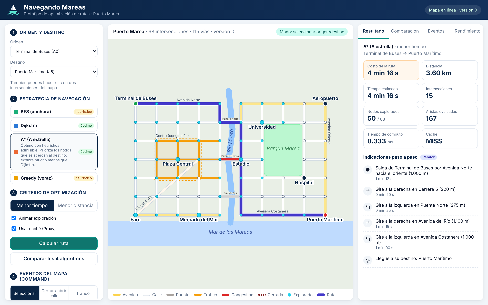

# Navegando Mareas · Optimización de rutas en mapas inteligentes

Prototipo académico (Arquitectura de Software · Actividad 6) que demuestra cómo una
arquitectura por capas y un conjunto de patrones de diseño (Strategy, Template Method,
Proxy, Observer, Command, Iterator, Facade y Registry/Factory) permiten **intercambiar,
comparar y optimizar estrategias de navegación** sobre el mapa de una ciudad.

La ciudad ficticia **Puerto Marea** (68 intersecciones, 115 vías) tiene un río que solo
se cruza por tres puentes, un parque que obliga a rodear, un centro congestionado y
avenidas rápidas, para que las diferencias entre algoritmos sean visibles.



## Funcionalidades

| Funcionalidad | Patrón |
|---|---|
| 4 algoritmos intercambiables: BFS, Dijkstra, A* y Greedy | Strategy + Template Method + Registry |
| 2 criterios de optimización: menor distancia / menor tiempo (con tráfico) | Strategy (criterio de costo) |
| Animación de los nodos explorados y dibujo de la ruta óptima | — |
| Comparación lado a lado de los 4 algoritmos (costo, nodos, ms, optimalidad) | — |
| Indicaciones paso a paso ("gire a la derecha en…") | Iterator |
| Caché LRU de rutas que se invalida cuando cambia el mapa | Proxy + Observer |
| Cerrar/reabrir calles y fijar tráfico con deshacer/rehacer | Command |
| Re-ruteo automático cuando un evento afecta la ruta activa | Observer |
| Prueba de escalabilidad en cuadrículas de hasta 80×80 desde la UI | — |
| API REST única hacia la lógica de negocio | Facade |

## Estructura

```
navegando-mareas/
├── app.py                  # Capa de presentación: API REST Flask
├── gunicorn.conf.py        # Servidor WSGI de producción (lee $PORT)
├── navigation/             # Núcleo de dominio y aplicación
│   ├── domain.py           #   Node, Edge, CityMap (Subject)
│   ├── costs.py            #   Criterios de costo + heurísticas admisibles
│   ├── strategies.py       #   BFS, Dijkstra, A*, Greedy, StrategyRegistry
│   ├── cache.py            #   RouteCache (Observer) + CachingRouteProxy
│   ├── commands.py         #   Comandos y CommandHistory (deshacer/rehacer)
│   ├── iterator.py         #   Route + TurnByTurnIterator
│   ├── observer.py         #   MapEvent, Subject, EventLog
│   ├── city.py             #   Puerto Marea y generador de cuadrículas
│   └── service.py          #   NavigationService (Facade) + ActiveRouteWatcher
├── templates/index.html    # Interfaz web
├── static/                 # CSS y JavaScript (SVG, sin dependencias)
├── tests/                  # 16 pruebas pytest (unitarias + API)
├── benchmark.py, plots.py  # Experimentos de rendimiento y gráficos
├── results/                # Resultados (JSON, CSV y gráficos)
├── docs/uml/               # Diagramas UML como código (PlantUML) + PNG
└── docs/capturas/          # Evidencia visual del prototipo
```

## Ejecutar en local

```bash
python -m venv .venv
# Windows: .venv\Scripts\activate   ·   Linux/macOS: source .venv/bin/activate
pip install -r requirements-dev.txt
python app.py                 # http://localhost:5000
```

Con el servidor de producción (Linux/macOS): `gunicorn app:app` → http://localhost:8000

## Pruebas y experimentos

```bash
pytest -q                     # 16 pruebas
python benchmark.py --plots   # genera results/*.json, *.csv y results/charts/*.png
```

## API REST

| Método | Ruta | Descripción |
|---|---|---|
| GET | `/health` | Estado del servicio |
| GET | `/api/map` | Mapa, algoritmos, criterios e historial |
| POST | `/api/route` | `{origin, destination, algorithm, criterion, use_cache}` |
| POST | `/api/compare` | Ejecuta los 4 algoritmos para un par origen/destino |
| POST | `/api/commands` | `{type: close\|open\|traffic, u, v, factor}` |
| POST | `/api/commands/undo` · `/redo` | Deshacer / rehacer |
| POST | `/api/reset` | Restablece el mapa |
| GET | `/api/events` · `/api/metrics` | Bitácora de eventos y métricas de caché |
| GET | `/api/benchmark?size=40&pairs=15` | Prueba de escalabilidad rápida |

## Despliegue

El repositorio incluye `Procfile`, `railway.json`, `render.yaml` y `.python-version`,
así que Railway y Render lo detectan sin configuración adicional. Comando de inicio:
`gunicorn app:app` · health check: `/health`.

> El estado del mapa vive en memoria; por eso Gunicorn corre con **1 proceso y 4 hilos**.
> Para escalar horizontalmente habría que mover el estado a un almacén externo (p. ej. Redis),
> como se analiza en el informe.

## Autor

[Nombre del estudiante] · Arquitectura de Software · [Universidad] · 2026
